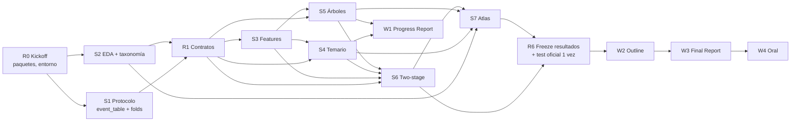

# Dependencias y reuniones de decisión

Complemento de [`plan-reparto.md`](./plan-reparto.md). IDs de scopes (S1–S11, W1–W4) y paquetes (A/B) son los de ese plan.
Regla general: **una decisión que bloquea a otra persona se toma en una reunión fijada, no por chat a medias**. Si no hay acuerdo, se aplica el *default* de la tabla 3 y se sigue.

---

## 1. Qué bloquea a qué

| Bloqueante | Bloquea a | Tipo | Mientras tanto, el bloqueado puede… |
|---|---|---|---|
| R0 Kickoff (paquetes + entorno) | todo | decisión | — (es hoy/mañana) |
| **S1** `event_table` + folds | S3, S4, S5, S6 | foundation | B: S2 entero (lee los CSV directamente) |
| **Regla de etiquetado** (en S1) | todos los modelos y métricas de validación | decisión | usar LRP/CRP para validar el pipeline |
| **Definición de jump** (en S2) | S6 (análisis de jumps), S7 | decisión | S6 empieza con F₂/MSE_HR globales |
| **R1 Contratos** | trabajo en paralelo de S3–S7 | decisión | nada en paralelo antes; trabajar en S1/S2 |
| S3 Features v1 | S4, S5, S6 (versión buena) | contrato | usar **features stub** (latest risk + 5 columnas) |
| S4 / S5 modelos | S6 con el mejor clasificador | contrato blando | S6 con logística (de S4 o propia) |
| S4 + S5 + S6 `preds/*.parquet` | S7 Atlas | secuencial blando | S7 con LRP + taxonomía de S2 |
| S4 + S5 (tabla preliminar) | W1 Progress Report | secuencial | redactar intro/data/protocolo antes |
| **R6 Freeze resultados** | W2, W3, slides | secuencial duro | redactar intro/data/método |
| Plantilla BAM Project LaTeX | W3 | externo | escribir en `sections/*.tex` sueltos |
| `requirements.txt` | todo lo que ejecuta código | foundation | — (se hace en Fase 0, ver §4) |

**Ruta crítica**: R0 → S1 (+ regla de etiquetado) → R1 → S3 → S5/S6 → R6 → W3. Un retraso aquí mueve la entrega; un retraso en S2/S4/S7 no, si se usan los stubs.

---

## 2. Calendario de reuniones

Tipos: **Decisión** (se sale con algo escrito en `docs/decisions/`), **Sync** (hill chart, 15 min), **Freeze** (se congela algo y no se reabre).

| # | Fecha (propuesta) | Tipo | Duración | Desbloquea |
|---|---|---|---|---|
| R0 | jue 15 oct | Decisión — kickoff | 45 min | S1, S2 |
| R1 | sáb 17 oct | Decisión — contratos | 60 min | S3–S7 en paralelo |
| — | **lun y jue**, desde 19 oct | Sync hill chart | 15 min | detectar bloqueos |
| R2 | jue 22 oct | Freeze C1 | 30 min | W1 |
| R3 | lun 26 oct | Decisión — kickoff C2 | 45 min | S6 diseño final, `~` a intentar |
| R4 | mié 4 nov | Decisión — midpoint | 30 min | cut back o seguir |
| R5 | mar 10 nov | **Freeze resultados** | 45 min | W2, W3 |
| R6 | jue 12 nov | Decisión — argumento del outline | 45 min | W2 |
| R7 | lun 16 nov | Decisión — kickoff report final | 30 min | W3 por secciones |
| R8 | dom 22 nov | Revisión cruzada | 60 min | entrega W3 |
| R9 / R10 | 2 ensayos antes de la sesión 27 | Ensayo oral | 60 min c/u | W4 |

Si el mid-term cae en alguna de estas fechas, se mueve la reunión, no el freeze.

---

## 3. Qué se decide en cada reunión

Formato por decisión: **quién trae la propuesta** (preparada antes, no se improvisa) · **default** si no hay acuerdo en la reunión.

### R0 — Kickoff (jue 15 oct)
| Decisión | Propone | Default |
|---|---|---|
| Quién coge paquete A y quién B | ambos | tirar una moneda |
| Horas reales/semana por persona | ambos | 7 h |
| Fechas del mid-term y del oral | quien las encuentre en Blackboard | bloquear 3 días antes del mid-term |
| Días/hora fijos de la sync | ambos | lun y jue, 15 min, después de clase |
| Dónde vive el hill chart | ambos | tabla en un issue fijado de GitHub |
| Entorno: Python + versiones (`requirements.txt`) | A | Python 3.11, versiones actuales instaladas, pinneadas |
| Mario añadido como colaborador; ramas `scope/<id>-<nombre>` | Pedro | — |

### R1 — Contratos (sáb 17 oct) — **la más importante**
Sale con `docs/contracts.md` + ADRs 025–028.
| Decisión | Propone | Default |
|---|---|---|
| **Regla de etiquetado train**: qué eventos se filtran, qué CDM da la etiqueta | A (tras leer Uriot et al.) | label = `risk` del último CDM; quedarse con eventos con ≥1 CDM ≥ 2 d y último CDM < 1 d |
| **Esquema de `event_table`** (columnas, tipos, 1 fila/evento) | A | `event_id, mission_id, n_cdm, latest_risk, …features…, y_final, y_hr, fold` |
| **Folds**: nº, agrupación, estratificación | A (con resultado del spike) | 5-fold GroupKFold por `event_id`, estratificado por `y_hr` |
| **Definición de jump** (umbral en log₁₀, ventana) | B (con figuras de S2) | jump-up = `y_final − latest_risk ≥ 1`; jump-down ≤ −1; resto stable-low/high según HR |
| **Interfaz de modelo** | A | clase sklearn-like `fit(X, y)`, `predict(X)` (r̂), `predict_proba(X)` (P(HR)) |
| **Formato de resultados** | B | `results/<modelo>.json` con el esquema de `prelim_results.json` + `fold` |
| **Formato de predicciones** | B | `preds/<modelo>.parquet`: `event_id, fold, p_hr, r_hat` |
| Dónde va el bootstrap/varianza | B | `src/evaluation.py` (de B); `metrics.py` (de A) no se toca |
| Uso del test oficial | ambos | **solo una vez**, en R5, con los modelos congelados |

### R2 — Freeze C1 (jue 22 oct)
| Decisión | Propone | Default |
|---|---|---|
| Qué modelos entran en el Progress Report | dueños S4/S5 | lo que esté en `main` el jueves |
| Problemas encontrados + decisiones a contar (lo pide el enunciado) | ambos | lista de ADRs 025+ |
| Reparto de párrafos del W1 | integrador (B) | cada uno escribe lo que construyó |

### R3 — Kickoff C2 (lun 26 oct)
| Decisión | Propone | Default |
|---|---|---|
| Diseño final del two-stage: calibrador, regresor de magnitud, cómo se combinan | B | isotonic + GBDT regresor sobre eventos con P(HR) > umbral |
| Features v2 (qué añadir tras ver importancias) | A | ninguna nueva si no hay evidencia |
| Qué `~` (S8/S9/S10) se intentan y quién | ambos | ninguno hasta R4 |
| Feedback del Progress Report (si llega) | ambos | — |

### R4 — Midpoint (mié 4 nov)
| Decisión | Propone | Default |
|---|---|---|
| ¿S5 y S6 están cuesta abajo en el hill? | dueños | si no: **cut back** S6 a logística calibrada + reliability |
| PyTorch (S8): go / no-go | dueño de S8 | **no-go** (ADR 010: ablación opcional) |
| Casos del atlas (lista inicial) | A | 5 FN duros + 5 jumps |

### R5 — Freeze resultados (mar 10 nov)
| Decisión | Propone | Default |
|---|---|---|
| Lista final de modelos, tablas y figuras | ambos | lo que esté en `main` y se regenere con un comando |
| **Evaluación única en el test oficial** | A | se corre en la reunión, juntos; se acepta el resultado |
| Qué pasa a *Future Work* | ambos | todo lo no terminado |

### R6 — Argumento del outline (jue 12 nov)
| Decisión | Propone | Default |
|---|---|---|
| Mensaje principal del paper (1 frase) y orden del argumento | integrador (A) | RQ1 → RQ2 → atlas → limitaciones |
| Qué figura sostiene cada claim | ambos | máx. 1 figura por claim |

### R7 — Kickoff report final (lun 16 nov)
| Decisión | Propone | Default |
|---|---|---|
| Dueño de cada sección (`sections/*.tex`) | integrador (B) | quien construyó el scope escribe su subsección |
| Plantilla BAM Project + `clean,twocolumn` + MLA | B | — |

### R8 — Revisión cruzada (dom 22 nov)
Cada uno lee **las secciones del otro** y las explica en voz alta; lo que no sepa explicar se aclara o se reescribe. Se revisa la Declaración de contribuciones e IA.

### R9 / R10 — Ensayos del oral
Cada uno presenta las diapositivas **del otro** y responde preguntas hostiles cruzadas (el oral evalúa la comprensión de cada miembro).

---

## 4. Syncs (lun y jue, 15 min)

1. Cada uno mueve sus scopes en el hill chart: subiendo (todavía averiguando) / bajando (solo ejecutar).
2. ¿Alguien está esperando algo del otro? → se resuelve ahí o se fija una mini-reunión ese día.
3. ¿Un scope lleva 3–4 días sin moverse? → partirlo, pairing o recortar (lista de cortes del plan §11).
4. ¿Ha aparecido una decisión que afecta a los dos? → se apunta para la siguiente reunión de decisión; si bloquea, se aplica el default y se escribe un ADR.

No se discute estado "por preguntar": lo que se ve en el hill chart y en `main` es el estado.

---

## 5. Cambios al plan derivados de este documento

- `requirements.txt` pasa a **Fase 0, paquete A** (lo necesita el día 1). S11 de B queda en README, bibliografía MLA y Declaración.
- El bootstrap/varianza va en `src/evaluation.py` (dueño B), no en `metrics.py` (dueño A).
- La definición de jump pasa a ser un **contrato** (R1), no una decisión interna de S2.
- El test oficial se evalúa **una sola vez**, en R5.
